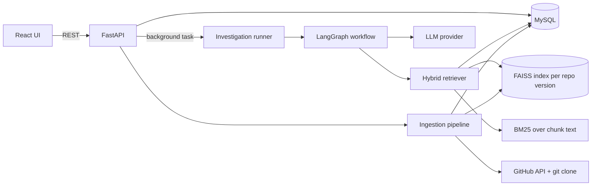
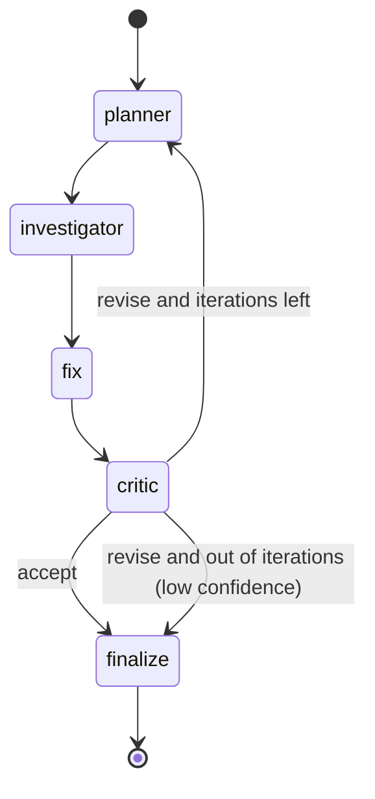
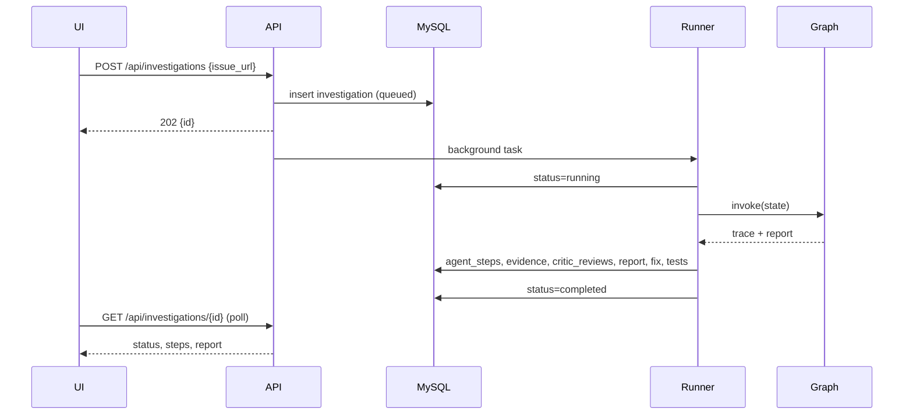

# 02 · Architecture

## System overview



Two separate flows:
1. **Ingestion** (per repo, re-run when HEAD changes): builds the searchable knowledge base.
2. **Investigation** (per issue): runs the agent graph against that knowledge base.

## Ingestion pipeline
1. Resolve repo → default branch → HEAD commit SHA. If an `index_versions` row with `status=ready` exists for that SHA, stop.
2. `git clone --depth` (history depth capped, e.g. 500 commits) into `data/repos/<owner>/<name>`.
3. Collect sources:
   - **code**: tracked source files (skip binaries, lockfiles, vendored dirs, files over a size cap).
   - **doc**: `*.md`, `docs/`.
   - **issue / pr**: via GitHub API (title, body, labels, state; PRs include changed file paths).
   - **commit**: message + changed file list per commit.
4. Chunk: code/docs by sliding line window (about 60 lines, 10 overlap) prefixed with the file path; issues/commits are one chunk each (split if long).
5. Embed with sentence-transformers (normalized vectors), add to `IndexFlatIP` wrapped in `IndexIDMap`, using `chunks.id` as the FAISS id.
6. Persist chunk text and metadata in MySQL, write the FAISS file under `data/indexes/<repo_id>/<version_id>.faiss`, mark the version `ready`.

## Retrieval
- **Dense**: FAISS cosine over chunk embeddings.
- **Sparse**: BM25 over chunk text (code identifiers and error strings match poorly in embeddings alone).
- **Fusion**: Reciprocal Rank Fusion, `score = Σ 1/(60 + rank)`, then top-k.
- Filters by `source_type`, so the planner can ask for "past issues about X" separately from "code that does X".

## Agent workflow (LangGraph)



| Node | Input | Output |
|------|-------|--------|
| **planner** | issue, critic feedback (if any), previous queries | hypotheses + retrieval queries with preferred source types |
| **investigator** | plan | retrieved evidence (merged across iterations) + root-cause analysis with cited evidence ids, affected files, confidence |
| **fix** | analysis + evidence | suggested diff + test cases |
| **critic** | everything above | verdict `accept`/`revise`, scores (groundedness, specificity, consistency), concrete feedback |

Guardrails (deterministic, not left to the LLM):
- Evidence ids cited by the investigator that were never retrieved are dropped.
- If no valid citation remains, the critic verdict is forced to `revise`.
- Loop is bounded by `MAX_ITERATIONS`; after that the report is returned with `low_confidence=true`.
- Token budget is checked between nodes.

### Shared state
`issue`, `iteration`, `max_iterations`, `critic_feedback`, `plan`, `evidence[]`, `analysis`, `fix`, `tests[]`, `review`, `low_confidence`, `trace[]` (append-only log of each node's output, written to `agent_steps`).

## Request flow



## API surface (MVP)
| Method | Path | Purpose |
|--------|------|---------|
| GET | `/health` | liveness |
| POST | `/api/repos` | register + start indexing |
| GET | `/api/repos` | list repos with index status |
| POST | `/api/investigations` | start an investigation from an issue URL |
| GET | `/api/investigations` | history |
| GET | `/api/investigations/{id}` | status, steps, report |
| GET | `/api/investigations/{id}/report.md` | Markdown export |
| POST | `/api/evals/run` | run eval cases (M4) |

## Failure handling
- GitHub rate limit → read `X-RateLimit-Reset`, back off, surface a clear error on the run.
- Bad LLM JSON → one repair retry, then mark the step failed and the run `failed` with the error stored.
- Indexing failure → `index_versions.status=failed` with error; investigations refuse to start on a non-ready index.

## Project layout
```
bug-investigator/
  docs/                    design docs (this folder)
  docker-compose.yml       MySQL + API
  backend/
    app/
      main.py              FastAPI app
      config.py            env-driven settings
      llm.py               provider-agnostic LLM + JSON parsing
      db/                  SQLAlchemy models + session
      github/              GitHub client, issue URL parsing
      retrieval/           retriever interface, RRF fusion, (M1) hybrid retriever
      agents/              state, prompts, nodes, graph
      api/                 routes
    scripts/export_schema.py   generates sql/schema.sql from the models
    sql/schema.sql
    tests/
  frontend/                Vite + React
```
