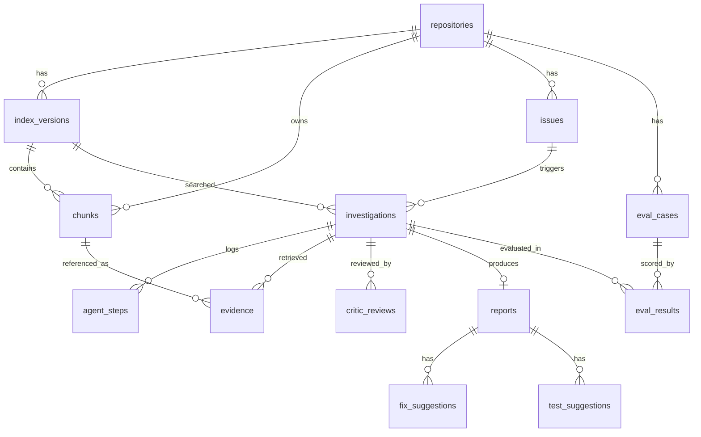

# 03 · Data Model

Source of truth: `backend/app/db/models.py`. The MySQL DDL in `backend/sql/schema.sql` is generated from it (`python -m scripts.export_schema`), so the two never drift.

## ER diagram



## Tables

**Knowledge base**
| Table | Purpose |
|-------|---------|
| `repositories` | A registered GitHub repo (`owner`, `name` unique). |
| `index_versions` | One searchable snapshot at a commit SHA: embedding model/dim, chunk count, FAISS file path, `building/ready/failed`. Re-indexing creates a new version instead of mutating the old one, so past investigations stay reproducible. |
| `chunks` | Retrievable text. `source_type` ∈ code/doc/issue/pr/commit, `source_ref` is the path, `#123` or commit SHA, optional line range, `content_hash`, JSON `meta` (language, labels, changed files…). `chunks.id` is also the FAISS vector id, so no mapping table is needed. |
| `issues` | Cached GitHub issues (the ones investigated, plus ingested history). |

**Runs**
| Table | Purpose |
|-------|---------|
| `investigations` | One run: status, iterations used, LLM provider/model, prompt version, token counts, confidence, error, timestamps. |
| `agent_steps` | Append-only log, one row per node execution: agent, iteration, JSON input/output, tokens, latency. This is what the UI timeline and replay read. |
| `evidence` | Chunks retrieved during a run with rank and score; `cited_in_report` marks what the final report actually relies on. |
| `critic_reviews` | Per-iteration verdict (`accept`/`revise`), JSON scores, feedback text. |

**Outputs**
| Table | Purpose |
|-------|---------|
| `reports` | Final root cause, summary, confidence, affected files, `low_confidence` flag, rendered Markdown. One per investigation. |
| `fix_suggestions` | File path + diff + explanation. |
| `test_suggestions` | Test name + code + rationale. |

**Evaluation**
| Table | Purpose |
|-------|---------|
| `eval_cases` | Closed issue + files changed in the linked fix PR (gold labels). |
| `eval_results` | Per case and per system (`agent` vs `bm25_baseline`): hit@1, hit@3, file recall. |

## FAISS layout
- One index file per `index_versions` row: `data/indexes/<repo_id>/<version_id>.faiss`.
- `IndexIDMap(IndexFlatIP(dim))` over L2-normalized embeddings (inner product = cosine). Vector id = `chunks.id`.
- Search returns ids → one `SELECT ... FROM chunks WHERE id IN (...)` to fetch text and metadata.
- BM25 is built in memory from `chunks.text` for the version when the retriever is first loaded (cached per version).

## Useful queries
```sql
-- Timeline of a run
SELECT iteration, seq, agent, latency_ms, tokens_in, tokens_out
FROM agent_steps WHERE investigation_id = :id ORDER BY seq;

-- Evidence the report relies on
SELECT c.source_type, c.source_ref, c.start_line, c.end_line, e.score
FROM evidence e JOIN chunks c ON c.id = e.chunk_id
WHERE e.investigation_id = :id AND e.cited_in_report = 1
ORDER BY e.rank;

-- How often the critic forces a second pass
SELECT iterations, COUNT(*) FROM investigations WHERE status = 'completed' GROUP BY iterations;

-- Agent vs baseline
SELECT system, AVG(hit_at_1), AVG(hit_at_3), AVG(file_recall) FROM eval_results GROUP BY system;
```
